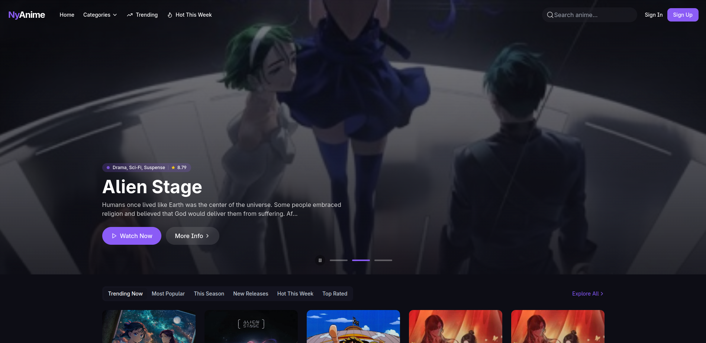

<h1 align="center">🌙 NyAnime — Your Gateway to Anime Streaming</h1>

<p align="center">
  
</p>

<p align="center">
  <b>A sleek, modern anime streaming platform.</b><br/>
  Built with love for anime fans. Inspired by Hianime, Zoro, and Ghibli vibes.
</p>

---

## 📺 About NyAnime

**NyAnime** is a community-driven anime streaming website with a beautiful dark interface, smooth playback, and real-time scraping for anime content. Designed for accessibility and speed, it's hosted on **Vercel** with frontend powered by **React + TypeScript + Vite**.

> ❝ Created for fans, by fans. Inspired by the community, backed by clean code. ❞

---

## ✨ Features

- 🎨 Aesthetic, dark-themed UI
- ⚡️ Fast loading with optimized lazy loading
- 🔍 Browse, search, and stream anime episodes
- 🧠 Scraper integration for real-time video links
- 🖼️ Dynamic episode thumbnails via CDN
- 🧩 Modular, extendable codebase
- 🤖 Discord support server for user queries
- 📱 Fully responsive across devices

---

## 🚀 Tech Stack

| Technology        | Description                       |
|-------------------|-----------------------------------|
| `React + TypeScript` | Frontend Framework              |
| `Vite`            | Fast build tool for development   |
| `Tailwind CSS`    | Utility-first CSS framework       |
| `Radix UI`        | Accessible UI components          |
| `React Query`     | Efficient data fetching + caching |
| `Vercel`          | Hosting & deployments             |

---

## 🛠️ Getting Started

```bash
# Clone the repository
git clone https://github.com/yourusername/NyAnime.git

# Navigate into the project directory
cd NyAnime

# Install dependencies
npm install

# Start development server
npm run dev
```

---

## 💡 Why NyAnime?

- ✅ No ads. No paywall. Pure streaming.
- 🧩 Open-source — contribute & fork freely.
- 🌐 Perfect for anime fans who want a better experience than most free platforms.
- ❤️ Built with love by anime lovers. And catgirls (maybe).

---

## 🤝 Collaborators

| Name              | Role                        |
|-------------------|-----------------------------|
| **Discord Kitten** | 💻 Developer, Designer       |
| **Mr. Banana**      | 🔧 Tech Consultant (WIP)     |
| You?               | ⭐ Open to contributions!     |

---

## 🌐 Links

- 🔗 **Website:** [NyAnime](https://nyanime-coral.vercel.app/)
- 💬 **Join Us on Discord:** _Coming Soon_
- 🧠 **Scraping API & Docs:** _Work in progress_

---

## 📸 Preview

<p align="center">
  
</p>

---

## 📜 License

MIT License — use freely, just don't forget to give credit!

---

> _"In a world full of filler episodes, be the main arc."_ — NyAnime 💜


## 🤖 Android app

The Android wrapper lives in `app/` and is ready for Google Play packaging:

```sh
./gradlew :app:bundleRelease
# -> app/build/outputs/bundle/release/app-release.aab
```

It loads `https://nyanime.cjhauser.me` with media autoplay, system Downloads
integration, file uploads, fullscreen video, and proper back navigation.
